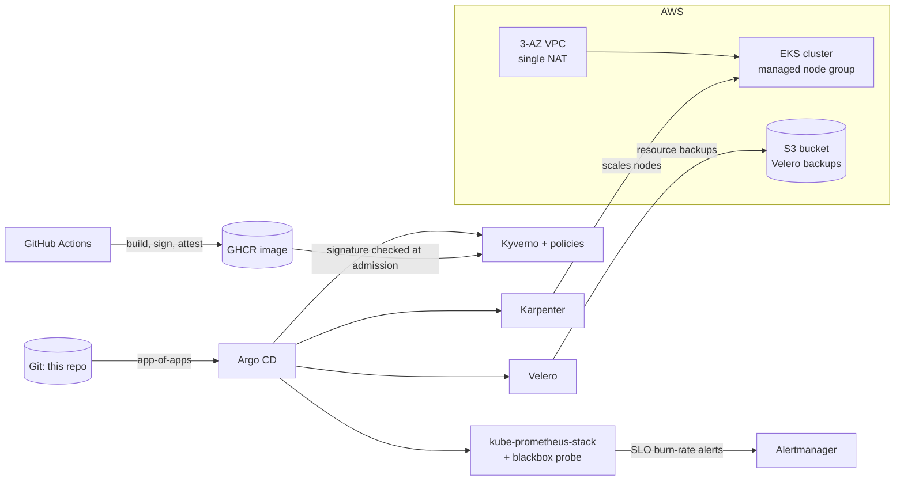

# EKS Production-Style Platform

[](https://github.com/mansuralamkhan/eks-setup/actions/workflows/ci.yml)

A hands-on platform engineering project on Amazon EKS: provisioning, node autoscaling, GitOps delivery, secrets management, admission policy, supply-chain security, SLOs and observability, and backups. Each module was built and run on a live cluster where noted, and the trade-offs behind every choice are written down as ADRs in [`docs/adr/`](docs/adr).

> **Status:** a working lab, not a one-command production platform. The tables below say what is implemented, what is tested only offline, and what is still manual. Anything marked *pending live run* has unit or schema tests but has not yet been exercised on a cluster.

## Architecture



## Modules

| Folder | What it contains | Status |
|---|---|---|
| `01-foundation/` | Terraform: 3-AZ VPC (single NAT gateway), EKS (KMS secret encryption, control-plane logs, API endpoint restricted to your CIDR), managed node group (IMDSv2, encrypted volumes), OIDC provider, Karpenter and ALB-controller IAM, Pod Identity, Karpenter discovery tags, Velero bucket and role | Implemented (live-tested before the latest changes; re-apply pending) |
| `02-autoscaling/` | Karpenter `EC2NodeClass` + `NodePool` | Implemented |
| `04-service-mesh/` | Istio gateway, 90/10 canary `VirtualService`, `DestinationRule`, `Service`, demo deployments | Lab |
| `05-gitops/` | Argo CD app-of-apps: ALB controller, Karpenter, demo-app, kube-prometheus-stack, blackbox exporter, Kyverno, Kyverno policies, observability config, Velero | Implemented, pending live sync |
| `06-secrets/` | External Secrets Operator `ClusterSecretStore` and `ExternalSecret`, IRSA trust-policy template | Implemented (ESO install and IAM role are manual) |
| `07-policy/` | Kyverno `disallow-latest-tag` and `verify-image-signatures` (both Audit), with offline tests | Implemented, signature check pending live run |
| `08-observability/` | Prometheus values, Grafana dashboard, availability SLO and burn-rate alerts, workload alerts, promtool tests, incident write-ups | Implemented, pending live fire drill |
| `app/demo-app/` | Small image built, signed and attested in CI | Implemented, pending first CI run |
| `docs/` | 10 ADRs, SLO definition, runbooks (image signing, restore drill) | |

There is no `03-` folder. The ALB controller's IAM role is in `01-foundation/modules/eks` and its Helm release is an Argo CD app.

## Decisions

| ADR | Decision | Status |
|---|---|---|
| 0001 | Karpenter over Cluster Autoscaler | Implemented |
| 0002 | Kyverno: Audit first, then Enforce | Implemented in Audit |
| 0003 | Argo CD app-of-apps | Implemented (ESO still manual) |
| 0004 | External Secrets Operator | Implemented (install and IAM manual) |
| 0005 | SLOs and error budgets | Implemented, unit-tested |
| 0006 | Terraform as the only IaC tool | Partial (no remote state yet) |
| 0007 | Prometheus/Grafana plus CloudWatch Container Insights | Implemented |
| 0008 | Cosign + SLSA, verified by Kyverno | Implemented in Audit, pending first run |
| 0009 | Multi-AZ plus Velero | Partial (resource backups only, no restore drill yet) |
| 0010 | Node access through SSM Session Manager | Implemented |

## Continuous integration

`ci.yml` runs on every push and pull request: `terraform fmt`/`validate`, `kubeconform` (core resources plus Karpenter, Argo CD, Kyverno, Prometheus Operator and Istio CRDs), Kyverno policy tests, `promtool` rule linting and unit tests (including every dashboard query), `gitleaks`, and a check that no `PIN_LATEST` or `REPLACE_VELERO_BUCKET` placeholder is left in `05-gitops`. `image.yml` builds, signs and attests the demo image.

## Real incidents

`08-observability/incidents/` documents two failures triggered on this cluster. Incident 01 (bad image tag) exposed that a restart-count panel cannot see `ImagePullBackOff`. The fix, a *waiting reason* panel and the `PodImagePullFailure` alert, is built and unit-tested; re-running the incident to watch it fire is still to do. Incident 02 (OOMKilled) still needs its original numbers recorded.

## Quickstart

Prerequisites: AWS credentials, Terraform, `kubectl`, Helm, `make`.

```bash
cp 01-foundation/terraform.tfvars.example 01-foundation/terraform.tfvars   # set public_access_cidrs to your IP/32
make up                    # terraform init + apply
make kubeconfig
make velero-bucket         # writes the bucket name into the Velero values
make pin                   # resolves chart versions into the Argo apps; review the diff
git add -A && git commit -m "chore: pin charts, set velero bucket" && git push
```

Then install Argo CD, create the Grafana admin secret (command in `08-observability/install/kube-prometheus-stack-values.yaml`), and apply the root app:

```bash
kubectl apply -f 05-gitops/apps/root-app.yaml
kubectl apply -f 02-autoscaling/      # once Karpenter is running
```

If you previously installed Kyverno, kube-prometheus-stack or Velero by hand with Helm, uninstall those releases first (or use a fresh cluster) so Argo CD owns them.

**Cost warning:** the EKS control plane and the NAT gateway bill continuously. Run `make down` when you finish a session.

## Known gaps

- **External Secrets Operator** is installed by hand and its IAM role is not in Terraform.
- **No remote Terraform state** and no PR-gated `plan` (ADR-0006).
- **Single NAT gateway** and a one-node managed baseline: the network is multi-AZ, egress and baseline capacity are not (ADR-0009).
- **IMDS hop limit is 2** so the ALB controller can discover the VPC; set `vpcId` in its Helm values and lower it to 1 to tighten this.
- **`al2023@latest`** in the `EC2NodeClass` drifts; pin it for reproducible nodes.
- **The `kubernetes` provider is configured inside the `eks` module.** Moving it to the root needs a state migration.
- **Velero covers resources, not volume data.** No stateful workloads need snapshots yet.
- **Signing and verification are untested live.** Image signature verification and the SLO alerts have offline tests only.
